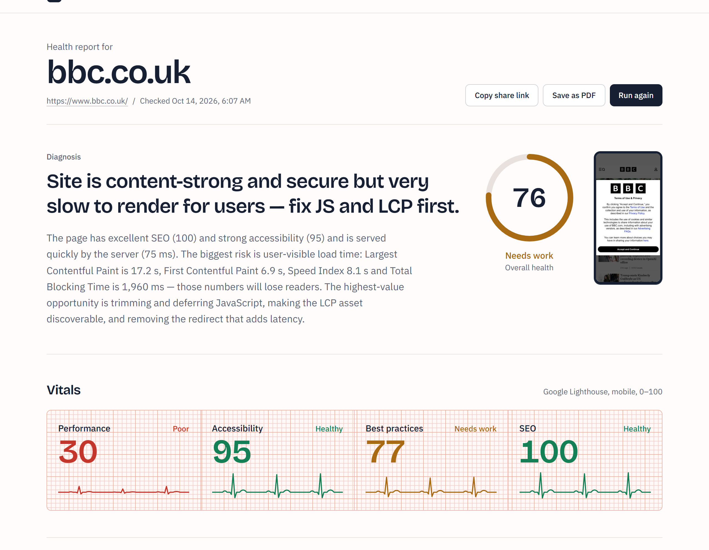

# SiteDoctor AI

Enter any website URL and get a health report: Lighthouse scores, Core Web Vitals, SEO, accessibility and security findings, and a prioritised treatment plan written by an AI model (GPT, Gemini or Claude). Every report has a shareable link and a share image, and can be saved as a PDF.

**Live demo:** https://sitedoctor-ai-nine.vercel.app



## How it works

```
POST /api/analyze  ──►  NDJSON stream of progress events, then the report
  ├─ PageSpeed Insights (Lighthouse, mobile)        src/lib/pagespeed.ts   ┐ run in
  ├─ Fetch + inspect HTML, headers, robots, sitemap  src/lib/inspect.ts    ┘ parallel
  ├─ Claude turns findings into a treatment plan     src/lib/insights.ts
  └─ Report cached 6 h (Upstash Redis or memory)     src/lib/store.ts
```

- **Lighthouse** supplies the four category scores, lab Core Web Vitals and a mobile screenshot.
- **SiteDoctor's own inspection** adds checks Lighthouse skips or reports vaguely: sitemap and robots.txt, structured data, Open Graph tags, security headers (HSTS, CSP, nosniff, framing), mixed content, compression, redirect chains, server response time, and counts for missing alt text, unlabeled fields and empty links.
- **An AI model** (Claude Opus 5.5, Gemini 2.5 Pro or GPT-5 mini; structured output validated with Zod) merges related findings into 3–6 ordered priorities with impact and effort, plus quick wins and strengths. On the Anthropic API, server-side refusal fallback is enabled (`fallbacks: "default"`).
- **Graceful degradation:** if Lighthouse is unavailable, scores are estimated from the inspection and labelled as such; if Claude is unavailable or no key is set, a rules-based plan is generated.
- **Safety:** URLs are validated and every redirect hop is checked against private and link-local IP ranges (SSRF guard); responses are size-capped; requests are rate-limited per IP.

## Run locally

```bash
npm install
cp .env.example .env.local   # add your keys
npm run dev
```

| Variable | Needed | Purpose |
| --- | --- | --- |
| AI model credentials (one provider) | Recommended | AI treatment plan. Without them, a rules-based plan is used. See below. |
| `PAGESPEED_API_KEY` | Recommended | Lighthouse scores. Keyless requests share a global quota that is usually exhausted. [Get a free key](https://developers.google.com/speed/docs/insights/v5/get-started). |
| `UPSTASH_REDIS_REST_URL` / `_TOKEN` | Optional | Shared report cache and rate limiting across serverless instances. |
| `NEXT_PUBLIC_AUTHOR_NAME`, `_AUTHOR_URL`, `_REPO_URL` | Optional | Footer credits. |

### Choosing the AI model

The treatment plan can come from Claude (on four platforms), Gemini or GPT, picked with `LLM_PROVIDER` (or inferred from the credentials present). Every provider gets the same prompt and the same JSON schema. See `src/lib/llm.ts`, `src/lib/insights.ts` and `.env.example`.

| `LLM_PROVIDER` | Platform | Credentials |
| --- | --- | --- |
| `anthropic` | Anthropic API | `ANTHROPIC_API_KEY` |
| `vertex` | Google Vertex AI | `ANTHROPIC_VERTEX_PROJECT_ID`, `CLOUD_ML_REGION`, and `GOOGLE_CREDENTIALS_JSON` (service-account key) on Vercel |
| `bedrock` | Amazon Bedrock | `BEDROCK_AWS_REGION` plus `AWS_BEARER_TOKEN_BEDROCK` or `BEDROCK_AWS_ACCESS_KEY_ID` / `BEDROCK_AWS_SECRET_ACCESS_KEY` |
| `foundry` | Microsoft Foundry (Azure) | `ANTHROPIC_FOUNDRY_RESOURCE`, `ANTHROPIC_FOUNDRY_API_KEY` |
| `gemini` | Gemini on Vertex AI | `GOOGLE_CLOUD_PROJECT`, `GOOGLE_CLOUD_LOCATION`, `GEMINI_MODEL`, and `GOOGLE_CREDENTIALS_JSON` on Vercel |
| `azure-openai` | Azure OpenAI (GPT) | `AZURE_OPENAI_ENDPOINT`, `AZURE_OPENAI_API_KEY`, `AZURE_OPENAI_DEPLOYMENT` |

For Claude, enable Claude Opus 5.5 in your cloud console first (Vertex Model Garden, Bedrock model access, or a Foundry deployment; Azure free-trial subscriptions can't deploy Claude). Server-side refusal fallback is only available on the Anthropic API; on the other platforms a refusal falls back to the rules-based plan.

## Deploy to Vercel

1. Push this folder to a GitHub repository and import it in Vercel.
2. Add `PAGESPEED_API_KEY` and the credentials for your Claude platform under Project Settings → Environment Variables.
3. Optional: add the **Upstash for Redis** integration from the Vercel Marketplace. Without it, cached reports live in each function instance's memory, so a shared link may re-run the checkup.

The analysis route sets `maxDuration = 120`; Lighthouse alone can take 15–40 s.

## Stack

Next.js 16 (App Router, cache components), React 19, Tailwind CSS 4, TypeScript, `@anthropic-ai/sdk` (+ `vertex-sdk`, `bedrock-sdk`, `foundry-sdk`), `@google/genai`, `openai`, cheerio, zod, Upstash Redis.
